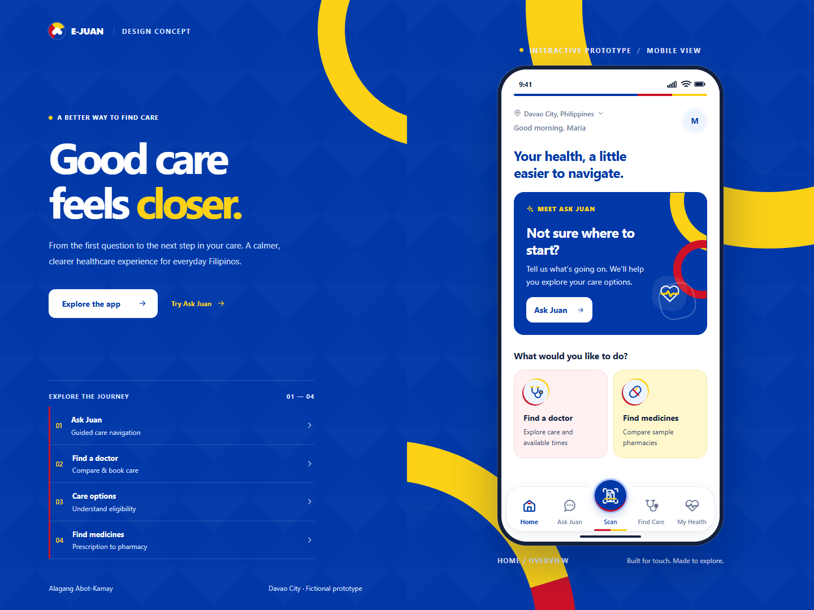

# E-JUAN

### Alagang Abot-Kamay

**Good care feels closer.**

A healthcare navigation and care coordination prototype for Davao City.

**Mobile-first** · **Offline demo** · **No installation required**

[Quick start](#quick-start) · [Features](#what-you-can-explore) · [User journey](#the-care-journey) · [Demo boundaries](#demo-boundaries)

<em>The current Home screen. Desktop shows the phone showcase; mobile opens the full-screen app.</em>

---

E-JUAN brings the next steps in care into one place: describe a concern, explore doctors and sample appointment times, understand care options, review prescriptions, and find medicine listings. Its **23 screens** use local fictional data so the entire journey can be explored in a browser.

> **Interactive prototype only.** E-JUAN does not provide medical diagnosis, live consultations, real bookings, payments, eligibility verification, or verified pharmacy stock.

## Quick start

1. Download or clone this repository.
2. Open [index.html](index.html) in Chrome, Edge, Firefox, or Safari.
3. Start from **Home**, or choose **Ask Juan**, **Scan**, **Find Care**, or **My Health** in the bottom navigation.

No package install, account, API key, internet connection, or backend is required.

### Competition pitch

Open [the 24-slide E-JUAN pitch](pitch/index.html) directly, or visit `/pitch/` on your local server. It uses real prototype screenshots, the current branding, and a problem-first story with separate need, opportunity and feasibility slides and three-presenter notes. Arrow keys / Space navigate, **F** enters fullscreen, and **N** shows speaker notes. A [PDF version](pitch/E-JUAN-Pitch.pdf) and [presenting guide](pitch/README.md) are included. The original app remains independent of the presentation.

For a local HTTP preview, if Python is installed, run this from the project folder:

~~~bash
python -m http.server 4173 --bind 127.0.0.1
~~~

Then open [localhost:4173](http://127.0.0.1:4173).

## What you can explore

| Destination | What it does in the demo |
| --- | --- |
| **Home** | Care shortcuts, an introduction to Ask Juan, medicine discovery, and care-option information. |
| **Ask Juan** | Describe a concern, answer three guided questions, and explore suggested care and doctor matches. Includes urgent-warning and connection-retry paths. |
| **Scan** | Open the camera, frame a prescription, and take a local photo. Upload is a secondary option. Review editable sample fields and search for medicine listings. Uses the raised **Rx prescription** action. |
| **Find Care** | Browse fictional doctors; expand the compact search; combine availability, specialty, and consultation-mode filters; view profiles and choose sample slots. Search drafts and typing focus survive filter updates. |
| **My Health** | Open sample appointments, aftercare summaries, the prescription wallet, and the scanner. Identified by the heartbeat icon. |
| **Find medicines** | Search the example medicine, compare three fictional pharmacy branches in list or map view, inspect price/stock scenarios, and open branch details. Accessible through Home, prescriptions, and Scan. |

The interface uses E-JUAN flag blue, visible red/yellow accents, white pharmacy cards, light-blue doctor directory cards, and a rounded navigation bar with a raised center Scan button.

## The care journey

~~~mermaid
flowchart LR
    A[Ask Juan or Find Care] --> B[Choose a doctor]
    B --> C[Choose mode, day and time]
    C --> D[Check care options]
    D --> E[Review and confirm]
    E --> F[Sample consultation]
    F --> G[Aftercare and prescription]
    G --> H[Find medicines]
~~~

1. **Find a starting point.** Tell Ask Juan what is going on, or browse doctors directly. Guided intake asks who needs care, how long the concern has lasted, and about warning signs. Urgent warning descriptions or answers lead to separate urgent-care guidance.
2. **Choose a doctor.** Care matches show fictional doctors immediately. Compare available-now or later options, choose from a card, or inspect the profile first.
3. **Choose how and when to talk.** Pick video, voice, or text when supported, then select a sample day and time. Days without slots show an unavailable state; Pediatrics demonstrates a provider without online slots.
4. **Review care options.** Choose standard booking, a fictional approved LGU-beneficiary scenario, or separate PhilHealth YAKAP guidance.
5. **Confirm your choices.** Review the fee, schedule, and pathway. Sharing the Ask Juan summary is optional and unchecked by default. Confirmation creates a local sample booking without contacting a provider or charging money.
6. **Explore aftercare.** Try a simulated consultation, open the example aftercare or prescription, and continue to pharmacy discovery. These records are also accessible from My Health.

## Care options stay separate

| Pathway | Prototype behavior |
| --- | --- |
| **Standard consultation** | Continue with the displayed sample fee. No benefit verification is required. |
| **LGU-funded consultation** | Funding is shown only in the explicitly approved sample beneficiary scenario. Pending or unverified states can continue with standard booking. Provider, service, entitlement, and budget approval are not inferred. |
| **PhilHealth YAKAP** | View guidance toward an applicable accredited primary-care clinic. It is not an automatic discount or subsidy for the selected online consultation. |

PhilHealth verification does **not** establish LGU-funded eligibility. A possible monthly free-consultation ceiling remains a proposed, configurable concept—not a confirmed entitlement.

## Demo boundaries

- **Care navigation, not clinical advice.** Ask Juan suggests pathways; it does not diagnose, prescribe, or verify that a specialist is suitable.
- **Fictional providers and bookings.** Names, credentials, reviews, fees, availability, consultations, and confirmations are sample data. “Available now” means available in the demo scenario.
- **Local camera capture; sample fields, not OCR.** Camera access starts when you choose Open camera. Captured photos stay in the browser session; the camera stops after capture or leaving the scanner. Selecting an uploaded file records its name without reading or sending its contents. Both paths show preset editable fields, not information extracted from your photo. No OCR or QR decoding is connected. Camera access needs browser permission and a [secure context such as HTTPS or localhost](https://developer.mozilla.org/en-US/docs/Web/API/MediaDevices/getUserMedia); upload and the sample preview remain available as fallbacks.
- **Sample medicine listings.** Only **Paracetamol 500 mg** has example results. Other medicine searches show an empty state. Prices, distances, map locations, and stock updates are fictional; contact and directions actions are demonstrations.
- **Local session state.** Data stays in browser memory and resets when the page is refreshed. No account, cloud storage, patient-record transmission, government connection, payment, or production AI integration is implemented.

## Project structure

~~~text
e-juan-prototype/
├── index.html          # App shell and shared SVG icons
├── styles.css          # E-JUAN branding and responsive layouts
├── app.js              # Screens, local demo data, and interactions
├── assets/             # Illustrated fictional clinician portraits
├── docs/
│   └── images/
│       └── home-desktop.png
├── DESIGN_NOTES.md     # Product decisions and flow rules
└── README.md
~~~

Read [DESIGN_NOTES.md](DESIGN_NOTES.md) for the reasoning behind the care journey and eligibility rules. The existing preview-*-v2.png files are earlier screen snapshots; the main-page image above reflects the current interface.

---

<strong>E-JUAN · Alagang Abot-Kamay</strong> Davao City · Interactive healthcare design concept

